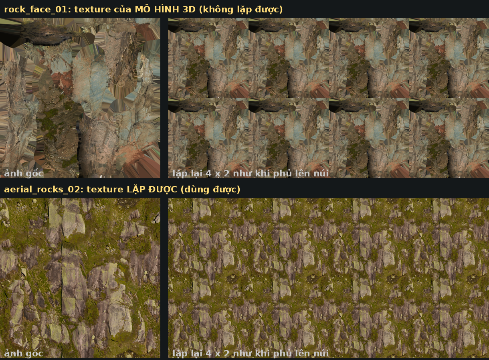
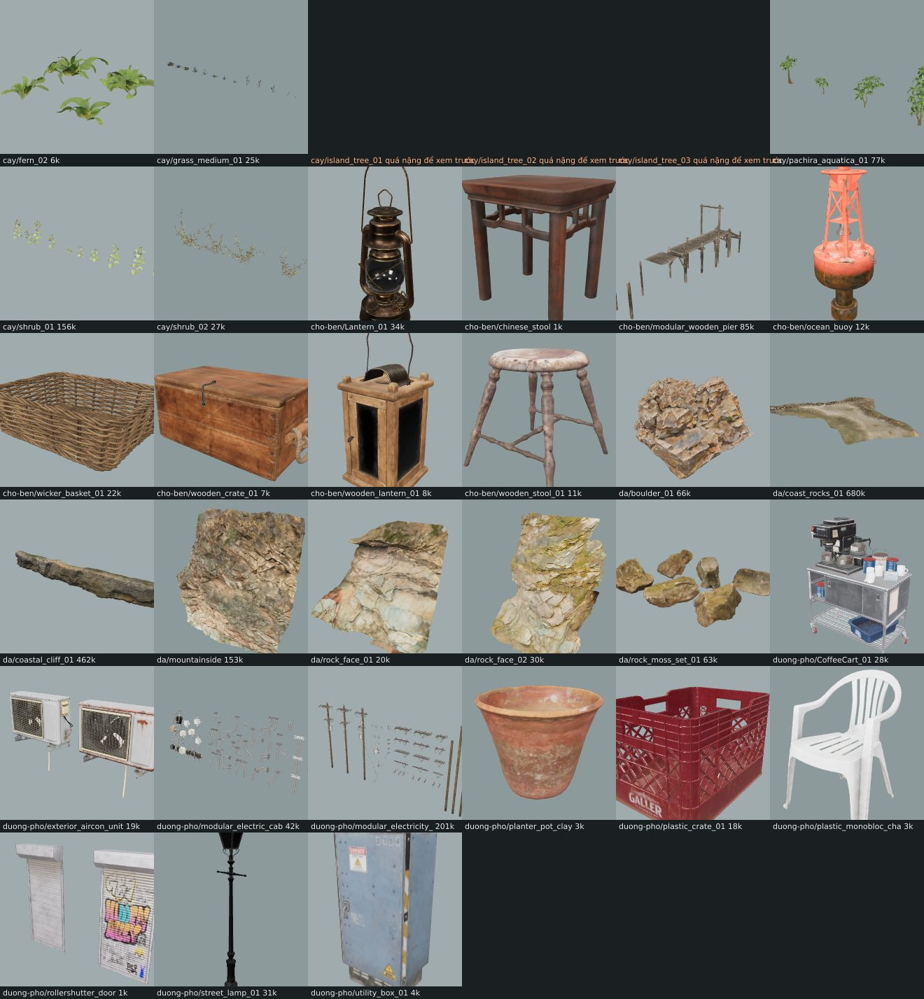
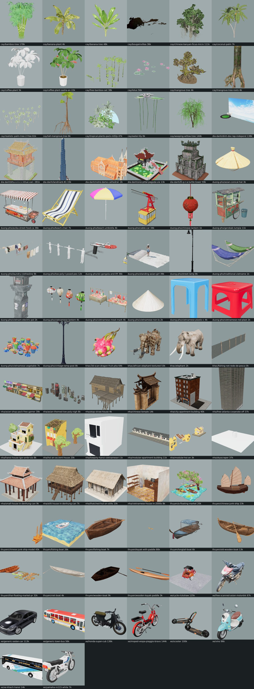

# Asset

| Phần | Tình trạng |
|---|---|
| 1. Texture (51 bộ) | **Xong.** Mình đã chọn và tải từ Poly Haven, ambientCG. |
| 2. Mô hình Poly Haven (33 cái) | **Xong.** Đá, vách núi, cây nhiệt đới, cột điện, dây điện, cục nóng điều hòa, cửa cuốn, ghế nhựa, cầu gỗ… |
| 3. Model Sketchfab (86 cái) | **Xong.** Mình tải bằng token của bạn và kiểm tra từng cái: 74 tốt, 5 cần xử lý thêm, 7 không dùng. |
| 4. Meshy | **Bạn làm**: tải 3 model đã có, làm 15 model mới theo 4 mức ưu tiên (mục 4). |
| 5. Không có model tốt | Mình làm bằng code (mục 5). |

Texture và mô hình ở mục 1, 2, 3 không nằm trong git (khoảng 1 GB). Tải lại bất cứ lúc nào bằng:

```bash
python3 tools/library/fetch.py
```

Danh sách mục 1, 2 nằm ở `tools/library/library.json`, đều CC0; file ghi nguồn sinh ra ở `assets/library/CREDITS.md`. Mục 3 là CC Attribution, có lệnh tải riêng (xem mục 3).

---

## 1. Texture (xong)

| Nhóm | Texture |
|---|---|
| rock | [Rock059](https://ambientcg.com/view?id=Rock059), [Rock036](https://ambientcg.com/view?id=Rock036), [rock_01](https://polyhaven.com/a/rock_01), [rock_boulder_dry](https://polyhaven.com/a/rock_boulder_dry), [rock_3](https://polyhaven.com/a/rock_3), [dry_river_pebbles](https://polyhaven.com/a/dry_river_pebbles), [river_small_rocks](https://polyhaven.com/a/river_small_rocks) |
| ground | [red_laterite_soil_stones](https://polyhaven.com/a/red_laterite_soil_stones), [red_dirt_mud_01](https://polyhaven.com/a/red_dirt_mud_01), [brown_mud_03](https://polyhaven.com/a/brown_mud_03), [brown_mud_02](https://polyhaven.com/a/brown_mud_02), [dirt](https://polyhaven.com/a/dirt), [grass_path_2](https://polyhaven.com/a/grass_path_2) |
| grass | [Grass004](https://ambientcg.com/view?id=Grass004), [Grass001](https://ambientcg.com/view?id=Grass001), [grass_ground](https://polyhaven.com/a/grass_ground), [sparse_grass](https://polyhaven.com/a/sparse_grass), [leafy_grass](https://polyhaven.com/a/leafy_grass) |
| sand | [aerial_beach_01](https://polyhaven.com/a/aerial_beach_01), [dense_sand](https://polyhaven.com/a/dense_sand), [red_sand](https://polyhaven.com/a/red_sand) |
| road | [asphalt_01](https://polyhaven.com/a/asphalt_01), [concrete_pavers](https://polyhaven.com/a/concrete_pavers), [floor_pavement](https://polyhaven.com/a/floor_pavement), [square_brick_paving](https://polyhaven.com/a/square_brick_paving), [cobblestone_floor_08](https://polyhaven.com/a/cobblestone_floor_08), [concrete_floor_02](https://polyhaven.com/a/concrete_floor_02) |
| wall | [painted_plaster_wall](https://polyhaven.com/a/painted_plaster_wall), [damaged_plaster](https://polyhaven.com/a/damaged_plaster), [red_brick](https://polyhaven.com/a/red_brick), [brick_wall_006](https://polyhaven.com/a/brick_wall_006), [clay_plaster](https://polyhaven.com/a/clay_plaster), [excavated_soil_wall](https://polyhaven.com/a/excavated_soil_wall), [broken_wall](https://polyhaven.com/a/broken_wall), [stone_wall](https://polyhaven.com/a/stone_wall), [white_plaster_02](https://polyhaven.com/a/white_plaster_02), [concrete_wall_008](https://polyhaven.com/a/concrete_wall_008) |
| roof | [roof_09](https://polyhaven.com/a/roof_09), [roof_07](https://polyhaven.com/a/roof_07), [corrugated_iron](https://polyhaven.com/a/corrugated_iron), [rusty_corrugated_iron](https://polyhaven.com/a/rusty_corrugated_iron), [thatch_roof_angled](https://polyhaven.com/a/thatch_roof_angled), [riet_01](https://polyhaven.com/a/riet_01) |
| wood | [weathered_planks](https://polyhaven.com/a/weathered_planks), [brown_planks_03](https://polyhaven.com/a/brown_planks_03), [blue_painted_planks](https://polyhaven.com/a/blue_painted_planks), [green_rough_planks](https://polyhaven.com/a/green_rough_planks), [bamboo_wall_02](https://polyhaven.com/a/bamboo_wall_02), [bamboo_wall](https://polyhaven.com/a/bamboo_wall), [palm_tree_bark](https://polyhaven.com/a/palm_tree_bark) |
| metal | [rust_coarse_01](https://polyhaven.com/a/rust_coarse_01) |

Vì sao không dùng `rock_face_01/02` làm texture: đó là texture của **mô hình 3D**, phủ lặp lên núi sẽ lộ ô vuông và vệt kéo giãn. Bản mô hình của chúng đã có ở mục 2.



## 2. Mô hình Poly Haven (xong)



Ba cây `island_tree` quá nặng (1–2 triệu tam giác) để xem trước; khi lắp vào cảnh sẽ giảm xuống.

| Nhóm | Mô hình |
|---|---|
| da | [rock_face_01](https://polyhaven.com/a/rock_face_01), [rock_face_02](https://polyhaven.com/a/rock_face_02), [mountainside](https://polyhaven.com/a/mountainside), [coastal_cliff_01](https://polyhaven.com/a/coastal_cliff_01), [boulder_01](https://polyhaven.com/a/boulder_01), [rock_moss_set_01](https://polyhaven.com/a/rock_moss_set_01), [coast_rocks_01](https://polyhaven.com/a/coast_rocks_01) |
| cay | [island_tree_01](https://polyhaven.com/a/island_tree_01), [island_tree_02](https://polyhaven.com/a/island_tree_02), [island_tree_03](https://polyhaven.com/a/island_tree_03), [fern_02](https://polyhaven.com/a/fern_02), [shrub_01](https://polyhaven.com/a/shrub_01), [shrub_02](https://polyhaven.com/a/shrub_02), [pachira_aquatica_01](https://polyhaven.com/a/pachira_aquatica_01), [grass_medium_01](https://polyhaven.com/a/grass_medium_01) |
| duong-pho | [modular_electricity_poles](https://polyhaven.com/a/modular_electricity_poles), [modular_electric_cables](https://polyhaven.com/a/modular_electric_cables), [exterior_aircon_unit](https://polyhaven.com/a/exterior_aircon_unit), [rollershutter_door](https://polyhaven.com/a/rollershutter_door), [street_lamp_01](https://polyhaven.com/a/street_lamp_01), [utility_box_01](https://polyhaven.com/a/utility_box_01), [plastic_monobloc_chair_01](https://polyhaven.com/a/plastic_monobloc_chair_01), [plastic_crate_01](https://polyhaven.com/a/plastic_crate_01), [CoffeeCart_01](https://polyhaven.com/a/CoffeeCart_01), [planter_pot_clay](https://polyhaven.com/a/planter_pot_clay) |
| cho-ben | [modular_wooden_pier](https://polyhaven.com/a/modular_wooden_pier), [wooden_lantern_01](https://polyhaven.com/a/wooden_lantern_01), [Lantern_01](https://polyhaven.com/a/Lantern_01), [ocean_buoy](https://polyhaven.com/a/ocean_buoy), [wicker_basket_01](https://polyhaven.com/a/wicker_basket_01), [wooden_crate_01](https://polyhaven.com/a/wooden_crate_01), [chinese_stool](https://polyhaven.com/a/chinese_stool), [wooden_stool_01](https://polyhaven.com/a/wooden_stool_01) |

## 3. Model Sketchfab (xong)

Mình đã tải cả 86 model bằng API token của bạn, vào `assets/library/sketchfab/` (ngoài git). Tải lại bằng:

```bash
SKETCHFAB_TOKEN=<token> python3 tools/library/fetch_sketchfab.py
cd tools && node library/fix.mjs   # đổi chất liệu kiểu cũ (specular/glossiness) để three.js hiển thị đúng màu
```

Mọi model là **CC Attribution**: khi đưa lên trang phải ghi tên tác giả. Tên tác giả và link đã lưu trong `tools/library/sketchfab.json`, file ghi công sinh ra ở `assets/library/sketchfab/CREDITS.md`.

Kết quả kiểm tra: ✅ tốt 74, 🔧 cần xử lý thêm 5, ⚠️ yếu 3, ❌ bỏ 4.



| | Nhóm | Thứ | Model | Tam giác | Tác giả | Ghi chú |
|---|---|---|---|---|---|---|
| ✅ | Địa danh | Nhà thờ Đức Bà | [Notre-Dame Cathedral Basilica of Saigon](https://sketchfab.com/3d-models/c3dfdc2be8504c4ba7ee076994a15108) | 2.187 | cgart.com | Đúng công trình, model nhẹ. So với bản Meshy rồi chọn. |
| ✅ | Địa danh | Landmark 81 | [Landmark 81](https://sketchfab.com/3d-models/cf68d02944c74d96933637fcc7e73021) | 15.462 | Dave Love SketchFab | Thay khối hộp hiện tại ở Sài Gòn |
| 🔧 | Địa danh | Dinh Độc Lập (thêm cho Sài Gòn) | [Dinh Doc Lap Independence Palace](https://sketchfab.com/3d-models/2c4905c6a1fd4fb18981886a77ba4fa9) | 148.496 | Hoàng Huy | Bỏ tấm phông trời đi kèm |
| ✅ | Địa danh | Chùa Một Cột (thêm cho Hà Nội) | [One Pillar Pagoda - Vietnam](https://sketchfab.com/3d-models/8475a13cd0ce41ffacd977eea63ac245) | 12.924 | stephenk232 |  |
| ✅ | Địa danh | Khuê Văn Các (thêm cho Hà Nội) | [Khuê Văn các - Khue Van pavilion](https://sketchfab.com/3d-models/bd978368dc0444058c6c61336ed8f2d0) | 281.122 | Heli Ton | Nặng, mình sẽ giảm |
| ✅ | Địa danh | Tháp Rùa (so với bản Meshy) | [Tháp Rùa - Turtle Tower on Hoan Kiem Lake](https://sketchfab.com/3d-models/a22adcd051914e2e911debf0730cab28) | 59.400 | minhduc26119931 |  |
| ✅ | Xe | Xe máy số | [Honda Super CUB](https://sketchfab.com/3d-models/dfac2b92b05746709674bea223ee596d) | 136.279 | Azimut Cheng | Honda Super Cub, giống xe Việt Nam nhất |
| ✅ | Xe | Xe máy số | [Yamaha RX115 (White)](https://sketchfab.com/3d-models/f7c99cafa3b44d1ea8ff4c28c3fb1de5) | 6.720 | ashminggu | Yamaha RX115, nhẹ, dùng cho dòng xe đông |
| ✅ | Xe | Xe máy số | [Free Scanned Asian Motorbike](https://sketchfab.com/3d-models/f84369affafb46bbb797d497715e36ba) | 66.812 | Aung.Kyaw.Paing | Xe máy châu Á chụp quét |
| ✅ | Xe | Xe tay ga | [Vino](https://sketchfab.com/3d-models/2205f4e69bc64df3aab03c71ab9d7492) | 95.599 | minghauLoh | Yamaha Vino |
| ❌ | Xe | Xe tay ga | [Scooter](https://sketchfab.com/3d-models/8f5246e6bf854d4cb50dbe0e24e0addc) | 99.650 | re1monsen | Là xe trượt điện, không phải xe tay ga |
| ✅ | Xe | Xe tay ga | [Moped - Vespa Piaggio Bravo](https://sketchfab.com/3d-models/bb7549d851784b238b917ade58dad1c5) | 143.767 | Fredrik Johansen | Vespa |
| ✅ | Xe | Ô tô con | [Generic Sedan Car](https://sketchfab.com/3d-models/58c33766470d46e7b2aed542650494e5) | 113.191 | MMC Works | Sedan hiện đại |
| ✅ | Xe | Xe buýt, xe khách | [Xe Khach Hanoi](https://sketchfab.com/3d-models/6228a9c32be94ec88f501725837f7031) | 13.999 | Nguyễn Trung Đức | Xe khách Hà Nội |
| ✅ | Xe | Xe buýt, xe khách | [Generic Town Bus](https://sketchfab.com/3d-models/14fe03d792914d51b6c6250b393c44fd) | 55.542 | own.guest | Xe buýt thành phố |
| ✅ | Xe | Xích lô | [Cycle rickshaw](https://sketchfab.com/3d-models/704a942b531846bfbbfa067c24d501a5) | 125.368 | AryPadli | Xích lô kiểu Ấn Độ (người lái ngồi trước). Nếu không ổn, làm bằng Meshy. |
| ✅ | Thuyền | Đò, xuồng gỗ | [Viet Boat](https://sketchfab.com/3d-models/0c84f61608354ea6bf5606b4490aa057) | 3.594 | jojo_kyduyen | Thuyền Việt |
| ✅ | Thuyền | Đò, xuồng gỗ | [Wooden Boat](https://sketchfab.com/3d-models/627ba38e06aa4536b90706a8626c74d4) | 8.770 | donnichols |  |
| ✅ | Thuyền | Đò, xuồng gỗ | [Longtail boat](https://sketchfab.com/3d-models/35038e5b626b4609984f75e4cb978f7d) | 5.675 | jorandp | Thuyền đuôi dài |
| ✅ | Thuyền | Thuyền đánh cá | [Fishing boat](https://sketchfab.com/3d-models/f4b38ccf5ffb46018aa7931c0e106654) | 7.244 | Pabooklas |  |
| 🔧 | Thuyền | Thuyền đánh cá | [Fishing Boat](https://sketchfab.com/3d-models/6e33005fba3542a2aa61e187321d465e) | 26.682 | Rafael Rodrigues | Tách thuyền khỏi mảng nước |
| ✅ | Thuyền | Thuyền đánh cá | [Old wooden boat](https://sketchfab.com/3d-models/c62fa438ea0e464dbb23e0ca5ff03727) | 13.310 | pnhtuan | Thuyền gỗ cũ |
| ✅ | Thuyền | Chợ nổi (ghe, hàng hóa) | [A floating market](https://sketchfab.com/3d-models/0ce35d7f3a2d4a4eb747804f4d467840) | 20.355 | daydev | Cả cảnh chợ nổi, lấy ghe và hàng |
| ✅ | Thuyền | Chợ nổi (ghe, hàng hóa) | [Thai floating market props](https://sketchfab.com/3d-models/015fa8d96fd9467d9837be3628219ee5) | 31.780 | Biya | Đạo cụ chợ nổi |
| ✅ | Thuyền | Tàu buồm Hạ Long (thêm, đã có bản Meshy) | [Chinese Junk Ship Model](https://sketchfab.com/3d-models/dca48504de4e4794b790e249983238cc) | 43.426 | BG Builds |  |
| ✅ | Thuyền | Tàu buồm Hạ Long (thêm, đã có bản Meshy) | [Chinese Junk Ship](https://sketchfab.com/3d-models/a331d56c34ff4d958763114dc8e7c275) | 23.440 | Nisa Nurul Azizah |  |
| ✅ | Thuyền | Kayak | [Wooden Kayak & Paddle](https://sketchfab.com/3d-models/01cc514c5ace410ea4e5710cbfe89bb8) | 2.872 | Dominik Biały | Nhẹ |
| 🔧 | Thuyền | Kayak | [Kayak with Paddle](https://sketchfab.com/3d-models/cda3354816af4a0aa1ca5cfee6c5dcd7) | 79.658 | nayangway | Kèm vật ở xa, tách kayak ra |
| ⚠️ | Nhà | Nhà cổ Hội An | [Hoi An Accient House](https://sketchfab.com/3d-models/5507a8fbaeb449d5a91e83f0e202ba1c) | 19.912 | Le.Manh.Cuong | Kiểu khối vuông hoạt hình, lệch tông; nhà Hội An dựng bằng code |
| ⚠️ | Nhà | Nhà cổ Hội An | [Modular Hoi An](https://sketchfab.com/3d-models/0b502d56b0854274a0106deb293f0c98) | 3.437 | Son Nguyen | Bộ ghép nhà Hội An, nhẹ. Low-poly hoạt hình, lệch tông |
| 🔧 | Nhà | Nhà ống, nhà phố | [LowPoly Hanoi Vietnamese Tube House [Game Ready]](https://sketchfab.com/3d-models/a7b3525f0a9a439a994bcbfd8caaacaf) | 1.238 | RimiChama | Nhà ống Hà Nội, rất nhẹ. Không có texture, phủ texture tường và ngói của thư viện |
| ❌ | Nhà | Nhà ống, nhà phố | [Vietnamese House in 2000s](https://sketchfab.com/3d-models/582936c8eac641a885343e91766e71b1) | 8.490 | Khoa Nguyen | Nhà Việt những năm 2000. Là nội thất một phòng, không phải mặt ngoài |
| ✅ | Nhà | Nhà ống, nhà phố | [Hanoi House - Igor Ambrósio](https://sketchfab.com/3d-models/3958d56430b84c75bb79846d01d2e316) | 8.322 | Igor Ambrósio | Nhà Hà Nội |
| ✅ | Nhà | Nhà ống, nhà phố | [Asian Shop Pack Free Gameready](https://sketchfab.com/3d-models/2f603ad8d5c640f7b9794f6916f9fbdd) | 39.203 | abhayexe | Bộ cửa hàng châu Á |
| ✅ | Nhà | Nhà cao tầng ven sông Hàn | [Asian Themed Low Poly Night City Buildings](https://sketchfab.com/3d-models/9f0343aff4814b758dc6e905aba5b5e0) | 6.435 | 99.Miles | Bộ nhà châu Á ban đêm, rất nhẹ |
| ✅ | Nhà | Nhà cao tầng ven sông Hàn | [City Apartment Building](https://sketchfab.com/3d-models/7f77793a848643e4818280f17f1629a0) | 40.464 | fredbear1211 |  |
| ✅ | Nhà | Nhà cao tầng ven sông Hàn | [Modular Apartment Building](https://sketchfab.com/3d-models/a4553c5449f74dfb979cb6c5d891b063) | 11.276 | jimbogies |  |
| ✅ | Nhà | Tòa nhà văn phòng (Sài Gòn) | [[FREE]  Atlanta, Corperate Office Building](https://sketchfab.com/3d-models/d96380fb001345cca9a9be121f3e43d5) | 37.290 | 99.Miles |  |
| ❌ | Nhà | Tòa nhà văn phòng (Sài Gòn) | [Skyscraper](https://sketchfab.com/3d-models/9b571d0a6f34459e91aa38b6ef8e3d93) | 37.072 | ManySince910 | Không có texture |
| ✅ | Nhà | Nhà sàn Miền Tây | [Stilt house in DenHung (CanTho - VietNam)](https://sketchfab.com/3d-models/73b917a1b8564feaad1583dfe263c40b) | 6.600 | Wang Sh D | Nhà sàn Đền Hùng, Cần Thơ |
| ✅ | Nhà | Nhà sàn Miền Tây | [Small house in DenHung (CanTho - VietNam)](https://sketchfab.com/3d-models/335732e069d64197b22cf1093900430e) | 8.690 | Wang Sh D | Nhà nhỏ Cần Thơ |
| ✅ | Nhà | Nhà mái lá, nhà sàn (Tây Nguyên) | [Thatched Hut on Stilts](https://sketchfab.com/3d-models/b73d5d61395d45a2bd65768223fb28de) | 9.986 | rajoelinirinanear | Chòi mái lá trên cột |
| ✅ | Nhà | Nhà mái lá, nhà sàn (Tây Nguyên) | [Atap (straw) house](https://sketchfab.com/3d-models/f6dc892674be4265b0151f1534bee511) | 2.262 | 1catalogue | Nhà mái lá |
| ✅ | Nhà | Cổng chùa, đền (Huế) | [CHINESE TEMPLE](https://sketchfab.com/3d-models/0ffd9067916642779ae1c270d083d77f) | 14.212 | mervemacit | Đền kiểu Trung Hoa, gần kiến trúc Huế |
| ✅ | Đường phố, chợ | Cột điện Việt Nam | [Vietnam Electric Pole](https://sketchfab.com/3d-models/838358343f2a4a7e82cff10326207902) | 1.826 | Khoa Nguyen |  |
| ✅ | Đường phố, chợ | Đèn đường cổ | [Vintage lamp post](https://sketchfab.com/3d-models/56f6dcb3865144cd84e049ca6a736fae) | 8.170 | dasmodal |  |
| ✅ | Đường phố, chợ | Đèn đường cổ | [Street Lamp](https://sketchfab.com/3d-models/6881aa1e84b047d79860fa9297e05e22) | 7.810 | bez_glaza |  |
| ✅ | Đường phố, chợ | Ghế nhựa, ghế đẩu đỏ | [Vietnamese Red Plastic Stool — Game-ready PBR](https://sketchfab.com/3d-models/f07bfecbffa648c3b61227760901942b) | 1.500 | Saigon Sidewalk Assets | Ghế đẩu nhựa đỏ Việt Nam |
| ✅ | Đường phố, chợ | Ghế nhựa, ghế đẩu đỏ | [Vietnamese Plastic Chair](https://sketchfab.com/3d-models/25c585737c014827bfa3b56c2b680581) | 3.940 | kiim | Ghế nhựa Việt Nam |
| ✅ | Đường phố, chợ | Xe đẩy hàng rong | [煎饼车/Gerobak Lumpia](https://sketchfab.com/3d-models/bca4551289cb456dbf2de4ed91e4acfc) | 10.822 | billionlioe | Xe đẩy kiểu Đông Nam Á |
| ✅ | Đường phố, chợ | Xe đẩy hàng rong | [Avika Street Food Cart](https://sketchfab.com/3d-models/d54005c378fa45c3a06090d65a53fb23) | 36.653 | AVIKA |  |
| ✅ | Đường phố, chợ | Sạp chợ | [Vietnamese Vegetable Market](https://sketchfab.com/3d-models/a3c935d758624c8f866bc27776f86712) | 6.733 | Khoa Nguyen | Sạp rau Việt Nam |
| ✅ | Đường phố, chợ | Sạp chợ | [Vietnamese Meat Market stall](https://sketchfab.com/3d-models/0cd04f3c727347d9899b52b9b88be871) | 3.689 | Khoa Nguyen | Sạp thịt Việt Nam |
| ✅ | Đường phố, chợ | Dây phơi đồ | [Laundry Clothesline](https://sketchfab.com/3d-models/6f13cc3c463f43888fb5db634cc603aa) | 8.693 | Khoa Nguyen |  |
| ✅ | Đường phố, chợ | Đèn lồng | [Vietnamese Lantern](https://sketchfab.com/3d-models/e08d22e1d8364603a1cd10337d5f9da8) | 4.161 | Khoa Nguyen | Đèn lồng Việt Nam |
| ✅ | Đường phố, chợ | Đèn lồng | [Chinese Lantern](https://sketchfab.com/3d-models/0fc4dbf7122141828c16bae9025ce47c) | 1.412 | Batuhan13 |  |
| ✅ | Đường phố, chợ | Nón lá | [Vietnamese _ Non La](https://sketchfab.com/3d-models/abd86436d03344b9a40c82e127fb6252) | 1.512 | NNgan | Nón lá Việt Nam |
| ✅ | Đường phố, chợ | Nón lá | [Asian Conical Hat](https://sketchfab.com/3d-models/4eed68df8fb84284a91f42a6c6e4569c) | 3.234 | MushyDay |  |
| 🔧 | Đường phố, chợ | Người đi bộ | [Low Poly T-Posed People](https://sketchfab.com/3d-models/c17584fcc6f4471983319df260a5d5d8) | 11.998 | flyingspringrol | Bộ người low poly. Không có texture, dáng chữ T; chỉ dùng làm bóng người ở xa |
| ✅ | Đường phố, chợ | Người đi bộ | [Standing Asian girl](https://sketchfab.com/3d-models/b555f1fbaef64752a7b4b42e04fd6e7d) | 38.860 | moonsoulymoon | Cô gái châu Á |
| ✅ | Đường phố, chợ | Võng (thêm cho Miền Tây) | [Traditional Vietnamese Hammock](https://sketchfab.com/3d-models/35282e45dd3842f1911666afa3135426) | 1.458 | Khoa Nguyen | Võng Việt Nam |
| ✅ | Đường phố, chợ | Dù, ghế bãi biển (Nha Trang) | [Beach Umbrella](https://sketchfab.com/3d-models/1014ad7c8a4c4aa8ba5e88fc6151aa4f) | 3.832 | stealth86 | Dù |
| ✅ | Đường phố, chợ | Dù, ghế bãi biển (Nha Trang) | [Beach Chair](https://sketchfab.com/3d-models/57e9477018d244378302070a8738b566) | 7.376 | stealth86 | Ghế |
| ✅ | Đường phố, chợ | Cáp treo Bà Nà | [Cable Car](https://sketchfab.com/3d-models/1621ec805f3b460faf50cd61f7bcb98f) | 33.528 | ugarychev | Cabin |
| ✅ | Đường phố, chợ | Cáp treo Bà Nà | [Ski gongola and lift station detailed drafts](https://sketchfab.com/3d-models/a8fabd3e955643a2a9e9f09bd46635db) | 36.557 | Wilin_Amaurea | Cabin và nhà ga |
| ✅ | Cây | Tre | [Free Bamboo Set](https://sketchfab.com/3d-models/e9f9fa5397814f81bf85ad06acf5bf30) | 37.834 | JonhGillessen | Bộ tre |
| ✅ | Cây | Tre | [bamboo tree](https://sketchfab.com/3d-models/d0161434cf6844a8bc6eaeb0c0692ed0) | 184.941 | tojamerlin | Cây tre |
| ✅ | Cây | Dừa | [Coconut Palm](https://sketchfab.com/3d-models/26e787f2ff2e4c0fb004c3b0210805a3) | 7.432 | evolveduk | Nhẹ |
| ✅ | Cây | Dừa | [Realistic Palm Tree 2 Free](https://sketchfab.com/3d-models/d05c8ffb6ec64a7184c4b673e21f7224) | 60.764 | Next Spring | Chân thật |
| ✅ | Cây | Chuối (Miền Tây) | [Banana tree](https://sketchfab.com/3d-models/3b658ecad29f4d9a9606dbf8fea7c9bb) | 48.232 | 1Quad |  |
| ✅ | Cây | Chuối (Miền Tây) | [Banana Plant](https://sketchfab.com/3d-models/85695b82c7ba4b3497a663616cc3bf25) | 4.402 | evolveduk | Nhẹ |
| ✅ | Cây | Cây nhiệt đới tầng thấp | [Tropical Plants Pack M02P](https://sketchfab.com/3d-models/2f093afb792742438f0f7ba7eaab90f0) | 46.575 | MozzarellaARC | Bộ cây nhiệt đới |
| ⚠️ | Cây | Hoa giấy (Hội An) | [Bougainvillea](https://sketchfab.com/3d-models/3579fe79be0d46d49de80d5478a4e3cd) | 36.609 | amn009 | Tán hoa hiện thành mảng tối; làm hoa giấy bằng code nếu cần |
| ✅ | Cây | Liễu rủ (Hồ Gươm) | [Weeping willow tree](https://sketchfab.com/3d-models/48c090ce93d543cf8b19d3c6f2b6788a) | 144.348 | adam127 |  |
| ✅ | Cây | Cây đa | [Chinese Banyan (Ficus Microcarpa)](https://sketchfab.com/3d-models/2a0dbcdf8f5d48f5ad79987c7a8170ce) | 111.392 | Valery.Li | Cây đa (Ficus microcarpa) |
| ✅ | Cây | Sen, súng (Huế) | [LOTUS](https://sketchfab.com/3d-models/5627ae9572ce419fac75b68a2ac54594) | 55.636 | Amagi_Arts | Sen |
| ✅ | Cây | Sen, súng (Huế) | [Water lily](https://sketchfab.com/3d-models/04dd636204cd4b0db45a4fc82efa4385) | 360 | Mariia Melnik | Súng, rất nhẹ |
| ✅ | Cây | Cây cà phê | [Coffee Plant Sasha An](https://sketchfab.com/3d-models/cecd9cfe831b4282906064d622df850d) | 22.416 | xan1 |  |
| ❌ | Cây | Cây cà phê | [Coffee Plant](https://sketchfab.com/3d-models/0c5c4cd4e79b4015811914203d599b9d) | 5.244 | neutralize | Nhẹ. Không có texture |
| ✅ | Cây | Cây đước | [Mangrove Tree](https://sketchfab.com/3d-models/5d4542431caa46f0b6f1feb089fc19dd) | 4.268 | Nice2meetU2 |  |
| ✅ | Cây | Cây đước | [mangrove tree roots](https://sketchfab.com/3d-models/c32d977c14e04e5ebc1fbef9b6111957) | 3.926 | lucq22 | Rễ đước |
| ✅ | Cây | Cây đước | [Tall Mangrove Tree](https://sketchfab.com/3d-models/b722ee2895e84fd3b02a467cd1ba1cbe) | 3.096 | Matt Bodner | Đước cao |
| ✅ | Khác | Voi | [African Elephant Textured](https://sketchfab.com/3d-models/49ad44f03f374433ac3a4f3143d7980c) | 53.341 | JohnMesplay | Voi châu Phi, nhìn xa không khác |
| ✅ | Khác | Voi | [Elephant](https://sketchfab.com/3d-models/4ae161372d6a4219a87340339d1ffe03) | 1.958 | Rukh3D | Nhẹ |
| ✅ | Khác | Thanh long (quả, cho sạp chợ) | [3D Scan: Dragon Fruit / Pitaya](https://sketchfab.com/3d-models/c7833d1adf434d66a694d732f6dc5446) | 64.124 | Z3D | Cây thanh long mình làm bằng code |
| ✅ | Khác | Lưới đánh cá | [Fishing net (Rede de pesca)](https://sketchfab.com/3d-models/cab12e62c8dd46cdbb6b250c2a3c1306) | 112 | Alex Martire |  |

## 4. Meshy (bạn làm)

Chỉ gồm những thứ không có model miễn phí đủ tốt. Xếp theo mức cần, phòng khi credit không đủ cho cả danh sách.

### Mức 0: đã làm sẵn trên Meshy, chỉ cần tải về (không tốn credit)

| | Thứ | Ghi chú |
|---|---|---|
| [ ] | Chùa Cầu | Hội An là chặng hiện tại, quan trọng nhất |
| [ ] | Nhà thờ Đức Bà | Bản Sketchfab chỉ có 2 nghìn tam giác, bản Meshy chắc đẹp hơn |
| [ ] | Bưu điện Thành phố | |

### Mức 1: bắt buộc (khung cảnh chính)

| | Thứ | Prompt |
|---|---|---|
| [ ] | Chợ Bến Thành: **làm lại màu** (Retexture) | Ben Thanh Market, Saigon: cream and light grey concrete walls, red tiled roofs, clock tower at the main gate |
| [ ] | Nhà cổ Hội An, kiểu 1 tầng | Old shophouse in Hoi An ancient town, Vietnam: one storey, faded mustard yellow plaster walls, dark brown wooden doors and shutters, curved yin-yang clay tile roof with moss, red lanterns under the eaves |
| [ ] | Nhà cổ Hội An, kiểu 2 tầng | Two-storey old shophouse in Hoi An, Vietnam: mustard yellow plaster walls with stains, wooden balcony on the upper floor, dark wooden shutters, clay tile roof, bougainvillea on the facade |
| [ ] | Nhà ống phố cổ Hà Nội | Narrow tube house in Hanoi old quarter: three storeys, weathered pastel plaster, green wooden shutters, small balconies with iron railings, shop at street level, clay tile roof |
| [ ] | Nhà phố Sài Gòn | Narrow Saigon townhouse: five storeys, painted concrete facade, balconies with plants and iron railings, roller shutter shop front, air conditioning units, flat roof with water tank |
| [ ] | Tháp Chăm Pôshanư (Phan Thiết) | Cham tower Po Sah Inu, Phan Thiet, Vietnam: ancient red brick Hindu temple tower, square base, tiered roof, weathered bricks, on a small hill |
| [ ] | Cổng tam quan chùa Thiên Mụ (Huế) | Three-entrance gate of Thien Mu pagoda, Hue, Vietnam: traditional Vietnamese Buddhist gate, three arched doorways, upturned curved tile roofs, old moss-stained plaster |
| [ ] | Nhà trình tường Lô Lô (Lũng Cú) | Traditional Lo Lo ethnic house in Lung Cu, Ha Giang, Vietnam: thick rammed earth walls, yin-yang clay tile roof, wooden door, low stone fence around the yard |

### Mức 2: nên có (cảnh đúng chất Việt Nam)

| | Thứ | Prompt |
|---|---|---|
| [ ] | Xích lô Việt Nam | Vietnamese cyclo: three-wheeled bicycle taxi, passenger seat in front with a folding canopy, driver pedalling behind, metal frame painted dark red |
| [ ] | Thuyền rồng sông Hương (Huế) | Dragon boat on the Perfume River in Hue: wooden tourist boat with a carved colourful dragon head at the bow, roofed cabin, red and yellow paint |
| [ ] | Thuyền câu mực Nha Trang | Vietnamese squid fishing boat: wooden boat painted blue with red and white trim, rows of light bulbs hung over the deck, small wheelhouse |
| [ ] | Nhà bè làng chài Hạ Long | Floating fisherman house in Ha Long Bay: small wooden house on a raft of plastic floats, corrugated metal roof, fish farm cages around it |

### Mức 3: nếu còn credit

| | Thứ | Prompt |
|---|---|---|
| [ ] | Ngọ Môn, Đại Nội Huế | Ngo Mon gate of the Hue Imperial Citadel: massive stone base with three gates, two-tier wooden pavilion above with yellow and green glazed tile roofs |
| [ ] | Xe Honda Wave | Honda Wave underbone motorcycle, the most common motorbike in Vietnam, red and black |
| [ ] | Tàu du lịch Hạ Long | Ha Long Bay tourist cruise boat: white multi-deck wooden junk-style ship with brown sails |

### Cách làm và gửi file

- Nếu Meshy cho tạo từ ảnh (Image to 3D), dùng ảnh thật thường ra giống hơn prompt chữ.
- Xuất **GLB**, có texture. Nếu có ô chọn số polygon, khoảng **50–100 nghìn** là đủ, file nhẹ hơn nhiều.
- File Meshy thường nặng, quá giới hạn 25 MB khi upload web GitHub. Cách gửi dễ nhất: **bỏ vào một thư mục Google Drive** rồi gửi mình link. Phiên này có kết nối Google Drive nên mình tự tải về được.
- Thư mục `assets/incoming/meshy/` đang bị git bỏ qua. Nếu đẩy bằng git, dùng `assets/incoming/meshy-new/` (mỗi file dưới 100 MB).

## 5. Không có model tốt (mình làm bằng code)

Ruộng bậc thang và ruộng lúa, cây thanh long trên trụ, dừa nước, hoa tam giác mạch, thuyền độc mộc, nhà bè Hạ Long, phà, thác nước Tây Nguyên, cờ đỏ sao vàng (đã có).
