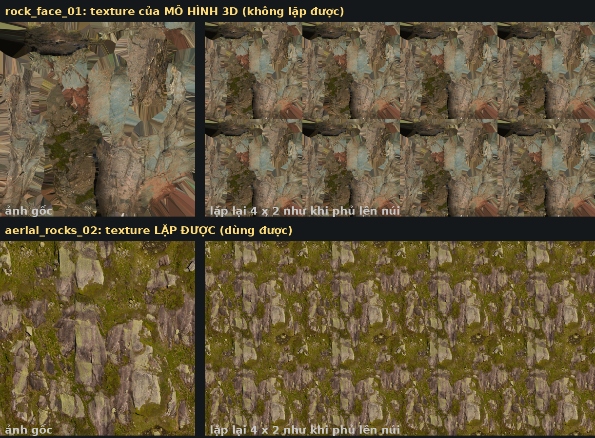

# Asset cần tải

Thứ tự làm: **1. Texture** → **2. Model địa danh (Meshy)** → **3. Model phụ trợ** (xe, thuyền, nhà, cây, đồ đường phố).

Tải xong nhóm nào thì push nhóm đó, không cần đợi đủ danh sách. Đánh dấu `[x]` khi đã có.

---

## 1. Texture

### Texture lặp được và texture của mô hình 3D

Chỉ **texture lặp được** (tileable, seamless) mới phủ được lên núi, đất, tường: ảnh lặp lại liên tục mà không thấy đường nối.

**Texture của mô hình 3D** (ví dụ `rock_face_01`, `rock_face_02` đã tải) là ảnh của **một vật cụ thể** bị cắt ra nhiều mảnh rồi xếp lên một tấm. Phần trống giữa các mảnh được kéo giãn thành vệt. Phủ lên núi sẽ thấy các ô vuông lặp lại và các vệt kéo giãn, nên không dùng làm texture được.

Mô hình đó vẫn có ích **dưới dạng mô hình**: tải bản **glTF** của `rock_face_01/02` thì mình đặt được như những khối vách đá thật ở Hà Giang và Hạ Long (xem mục 3).



Cách nhận ra khi tải:
- Chỉ chọn từ **trang danh sách texture**: https://polyhaven.com/textures. Trang chi tiết của texture và của mô hình đều có link dạng `/a/<tên>`, nên nhìn link không phân biệt được.
- Mở ảnh `_diff_`. Nếu nó trông như **nhiều mảnh ghép, có vệt màu kéo giãn** thì đó là texture của mô hình.

### Nguồn (đều CC0, dùng tự do, không cần ghi công)

| Nguồn | Link | Ghi chú |
|---|---|---|
| Poly Haven | https://polyhaven.com/textures | Chân thật nhất. Chọn **1K**. |
| ambientCG | https://ambientcg.com/list?type=material | Nhiều loại Poly Haven không có (ngói, mái tôn, mái lá, vữa, gạch lát). Chọn bản **1K-JPG**. Mọi "material" ở đây đều lặp được. |
| cgbookcase | https://www.cgbookcase.com/textures | Nguồn thứ ba nếu hai nguồn trên thiếu. |

Mỗi texture chỉ cần **ảnh màu** (`diff`, `color`, `albedo`) và **normal** (`nor_gl` hoặc `NormalGL`). Tải nguyên file zip cũng được, có thừa file hay normal dạng `.exr` cũng không sao.

### Đặt vào repo

```
assets/incoming/<nhóm>/<tên asset giữ nguyên>/
```

Nhóm: `rock`, `ground`, `grass`, `sand`, `road`, `wall`, `roof`, `wood`, `metal`. Mỗi loại con nên có **1–3 ứng viên**; mình ghép thử vào cảnh, chụp ảnh để bạn chọn. Không cần ghi mã loại con, mình tự nhận ra từ ảnh.

### Danh sách theo loại

⭐ = cần cho hai chặng làm chi tiết trước (Đà Nẵng, Hội An và Sài Gòn).

**A. Đá** (`rock`)

| | Loại | Dùng ở | Từ khóa |
|---|---|---|---|
| [ ] | A1. Vách đá vôi xám, vách đứng | Núi Hà Giang, đảo Hạ Long, đảo Nha Trang | `cliff`, `rock wall`, `limestone`, `rock` |
| [x] | A2. Đá lẫn rêu cỏ, nhìn từ trên | Đỉnh và sườn núi thoải | đã có `aerial_rocks_02` |
| [ ] | A3. Đá tảng granite xám nâu | Đồi Cù Lao (Ponagar), ghềnh đá ven biển | `granite`, `boulder`, `coast rocks` |
| [ ] | A4. Sỏi, đá cuội | Lòng suối, thác Tây Nguyên, bờ kè | `gravel`, `pebbles`, `river rocks` |

**B. Đất** (`ground`)

| | Loại | Dùng ở | Từ khóa |
|---|---|---|---|
| [x] | B1. Đất rừng lá mục | Sườn đồi dưới tán cây | đã có `forest_leaves_02` |
| [x] | B2. Đất bùn lốm đốm cỏ | Ruộng, đồng trống | đã có `brown_mud_leaves_01` |
| [ ] | B3. Đất đỏ bazan | Tây Nguyên, rẫy cà phê | `red soil`, `red dirt`, `laterite` |
| [ ] | B4. Bùn ướt bãi bồi | Rừng đước Cà Mau, ven sông Miền Tây | `mud`, `wet mud`, `river mud` |
| [ ] | B5. Đường đất nện | Bản Lô Lô Chải, buôn Tây Nguyên | `dirt road`, `dry ground`, `trail` |

**C. Cỏ, ruộng** (`grass`)

| | Loại | Dùng ở | Từ khóa |
|---|---|---|---|
| [ ] | C1. Cỏ xanh cắt ngắn | 168 ô cỏ Ba Đình, công viên | `grass`, `lawn` |
| [ ] | C2. Cỏ dại, cỏ khô | Sườn đồi Phan Thiết, Lũng Cú mùa khô | `dry grass`, `meadow`, `wild grass` |
| [ ] | C3. Ruộng lúa, mạ non | Ruộng bậc thang, đồng Miền Tây | `rice`, `paddy`, `crop`. Nếu không có, mình làm bằng shader và cây lúa 3D. |
| [x] | Bảng ngọn cỏ trong suốt | Trồng cỏ 3D ven sông | đã có `grass_bermuda_01` (không phải texture mặt đất) |

**D. Cát** (`sand`)

| | Loại | Dùng ở | Từ khóa |
|---|---|---|---|
| [x] | D1. Cát ướt bờ biển | Mép nước | đã có `aerial_beach_02` |
| [ ] | D2. Cát khô trắng mịn | Đồi cát trắng Mũi Né, bãi biển Nha Trang | `sand`, `dry sand`, `beach sand` |
| [ ] | D3. Cát đỏ cam | Đồi cát đỏ Mũi Né | `red sand`, `desert sand` |

**E. Đường, vỉa hè** (`road`)

| | Loại | Dùng ở | Từ khóa |
|---|---|---|---|
| [ ] ⭐ | E1. Đường nhựa | Sài Gòn, Đà Nẵng, Hà Nội | `asphalt`, `road` |
| [ ] ⭐ | E2. Vỉa hè lát gạch | Sài Gòn, Hà Nội, ven sông Hàn | `pavement`, `sidewalk`, `paving` |
| [ ] ⭐ | E3. Đường lát đá, gạch cổ | Phố cổ Hội An, Huế, bậc đá Lũng Cú | `cobblestone`, `stone floor`, `old brick floor` |
| [ ] | E4. Bê tông | Bến thuyền, kè, cầu | `concrete` |

**F. Tường** (`wall`)

| | Loại | Dùng ở | Từ khóa |
|---|---|---|---|
| [ ] ⭐ | F1. Tường vữa cũ loang lổ | Nhà vàng Hội An (màu vàng mình chỉnh bằng code, chỉ cần vữa sáng màu) | `plaster`, `stucco`, `painted plaster` |
| [ ] ⭐ | F2. Gạch đỏ | Nhà thờ Đức Bà, nhà cổ | `red brick`, `brick wall` |
| [ ] | F3. Tường đất trình tường | Nhà Lô Lô Chải, Lũng Cú | `rammed earth`, `clay wall`, `mud wall` |
| [ ] | F4. Tường đá xếp | Rào đá Hà Giang, chân tháp Chăm | `stone wall`, `rubble wall` |
| [ ] ⭐ | F5. Vữa trắng xám nhà phố | Nhà ống Sài Gòn, Hà Nội | `white plaster`, `concrete wall` |

**G. Mái** (`roof`)

| | Loại | Dùng ở | Từ khóa |
|---|---|---|---|
| [ ] ⭐ | G1. Ngói đất nung | Hội An, Huế, phố cổ Hà Nội, nhà Lô Lô Chải | `roof tiles`, `clay roof`, `terracotta` |
| [ ] | G2. Mái tôn | Nhà phố, nhà sàn Miền Tây | `corrugated metal`, `metal roof` |
| [ ] | G3. Mái lá, mái tranh | Nhà rông, nhà sàn, nhà Miền Tây | `thatch`, `straw roof` |

**H. Gỗ, tre** (`wood`)

| | Loại | Dùng ở | Từ khóa |
|---|---|---|---|
| [ ] ⭐ | H1. Ván gỗ cũ | Cầu gỗ Cà Mau, sàn nhà bè Hạ Long, bến Hội An | `wood planks`, `old wood`, `weathered wood` |
| [ ] ⭐ | H2. Gỗ sơn tróc | Thuyền, cửa gỗ nhà Hội An | `painted wood`, `peeling paint` |
| [ ] | H3. Tre, phên tre đan | Vách nhà, thuyền thúng | `bamboo`, `woven`, `wicker` |

**I. Kim loại** (`metal`, ít ưu tiên)

| | Loại | Dùng ở | Từ khóa |
|---|---|---|---|
| [ ] | I1. Sắt gỉ | Cầu, thuyền, mái tôn cũ | `rust`, `rusty metal` |

---

## 2. Model địa danh (Meshy)

| | Thứ | Ghi chú |
|---|---|---|
| [ ] | Chùa Cầu | **Quan trọng nhất**: Hội An là chặng hiện tại |
| [ ] | Nhà thờ Đức Bà | Sài Gòn |
| [ ] | Bưu điện Thành phố | Sài Gòn |
| [ ] | Chợ Bến Thành | Làm lại màu (Retexture) |

---

## 3. Model phụ trợ

### Quy tắc

| | Lấy | Tránh |
|---|---|---|
| Giấy phép | **CC0**, hoặc **CC BY** (chỉ cần ghi tên tác giả) | CC BY-NC (cấm thương mại), CC BY-ND (cấm chỉnh sửa), "Standard" hay "Editorial" của Sketchfab |
| Định dạng | **glTF / GLB**, có texture đi kèm | Chỉ có `.blend`, `.max`, `.c4d` |
| Kiểu | Chân thật hoặc bán chân thật, cùng tông | Hoạt hình, low-poly màu phẳng (trừ vật nhỏ ở xa) |
| Độ nặng | Một vật nên dưới 100k tam giác, mình tự giảm thêm | Model scan 1–5 triệu tam giác cho một vật nhỏ |

**Mỗi model một thư mục**, kèm file `nguon.txt` gồm 3 dòng: link trang tải, tên tác giả, giấy phép.

```
assets/incoming/models/<nhóm>/<tên>/
  scene.gltf (hoặc .glb), scene.bin, textures/...
  nguon.txt
```

Nhóm: `xe`, `thuyen`, `nha`, `cay`, `duong-pho`, `da` (vách đá, tảng đá), `chang-01` … `chang-11`.

### Tìm ở đâu

| Nguồn | Link | Giấy phép | Dùng cho |
|---|---|---|---|
| **Sketchfab** | https://sketchfab.com/search?features=downloadable&type=models&q=honda+wave | Lọc **License** ở cột trái: chọn *CC0* và *CC Attribution* | **Nguồn chính.** Nhiều nhất, có cả đồ Việt Nam: xe máy Honda, thuyền thúng, xích lô, nón lá. Cần tạo tài khoản miễn phí để tải. Khi tải chọn **glTF**. Đổi chữ sau `q=` để tìm thứ khác, thử thêm `vietnam`, `vietnamese`, `hoi an`, `saigon`. |
| **Poly Haven** | https://polyhaven.com/models | CC0 | Chân thật, ít đồ: đá, cây, bụi, đồ vật. `rock_face_01/02` bản glTF nằm ở đây. |
| **Poly Pizza** | https://poly.pizza | CC0 / CC BY (ghi trên từng model) | Low-poly, chỉ cho vật nhỏ ở xa. |
| **Quaternius** | https://quaternius.com | CC0 | Bộ thiên nhiên, xe cộ, kiểu đơn giản. |
| **Kenney** | https://kenney.nl/assets | CC0 | Hoạt hình, chỉ dùng khi hết cách. |

Trên Sketchfab, giấy phép ghi ở cột phải trang model (dòng "License"). Kiểm tra trước khi tải, vì kết quả tìm kiếm đôi khi lẫn model không cho tải hoặc có giấy phép khác.

Bỏ qua Fab (Megascans), CGTrader, TurboSquid, BlenderKit: giấy phép phức tạp hoặc không cho đưa file gốc lên một trang web công khai.

### Danh sách

**Ưu tiên 1: dùng chung cho nhiều chặng**

| | Thứ | Số loại | Từ khóa | Dùng ở |
|---|---|---|---|---|
| [ ] | Xe máy | 2–3 (xe số, tay ga, Vespa) | `honda wave`, `honda dream`, `scooter`, `vespa`, `motorbike` | Hà Nội, Đà Nẵng, Sài Gòn |
| [ ] | Ô tô con, taxi | 2 | `sedan car`, `taxi`, `toyota vios` | Đà Nẵng, Sài Gòn |
| [ ] | Xe buýt | 1 | `city bus` | Sài Gòn |
| [ ] | Thuyền gỗ nhỏ, xuồng | 2 | `sampan`, `wooden rowing boat`, `vietnamese boat` | Hạ Long, Huế, Hội An, Miền Tây |
| [ ] | Thuyền đánh cá | 2 | `fishing boat`, `vietnamese fishing boat`, `trawler` | Nha Trang, Phan Thiết, Cà Mau |
| [ ] | Nhà ống, nhà phố | 2–3 | `shophouse`, `asian shop house`, `vietnamese house`, `tube house` | Hà Nội, Hội An, Sài Gòn |
| [ ] | Đèn đường cổ | 1–2 | `vintage street lamp`, `street light` | Hà Nội, Sài Gòn, Đà Nẵng |
| [ ] | Bụi tre | 1–2 | `bamboo` | Lũng Cú, Huế, Miền Tây |
| [ ] | Cây dừa | 2 | `coconut palm` | Nha Trang, Phan Thiết, Miền Tây |
| [ ] | Dừa nước | 1 | `nipa palm` | Miền Tây, Cà Mau |
| [ ] | Vách đá, tảng đá | 2–3 | Poly Haven `rock_face_01`, `rock_face_02` (bản glTF), `cliff`, `boulder` | Hà Giang, Hạ Long, Nha Trang |
| [ ] | Người đi bộ (nhẹ, nếu có) | 3–5 | `low poly people`, `pedestrian` | Phố, chợ |

**Ưu tiên 2: theo chặng**

| | Chặng | Thứ | Từ khóa |
|---|---|---|---|
| [ ] | 01 Lũng Cú | Nhà đất, nhà trình tường mái ngói | `rammed earth house`, `mountain village house`, `asian village house` |
| [ ] | 01 Lũng Cú | Tường rào đá, bậc đá | `stone wall`, `stone stairs` |
| [ ] | 02 Hà Nội | Liễu rủ | `weeping willow` |
| [ ] | 02 Hà Nội | Cây đa | `banyan tree` |
| [ ] | 02 Hà Nội | Xích lô | `cyclo`, `rickshaw`, `pedicab` |
| [ ] | 02 Hà Nội | Ghế đá công viên | `park bench` |
| [ ] | 03 Hạ Long | Tàu du lịch nhiều tầng | `cruise boat`, `junk boat`, `river cruise` |
| [ ] | 03 Hạ Long | Nhà bè, làng chài nổi | `floating house`, `floating village`, `house boat` |
| [ ] | 03 Hạ Long | Kayak | `kayak` |
| [ ] | 04 Huế | Thuyền rồng | `dragon boat` |
| [ ] | 04 Huế | Cổng chùa, cổng tam quan | `pagoda gate`, `asian temple gate` |
| [ ] | 04 Huế | Sen | `lotus` |
| [ ] | 05 Đà Nẵng, Hội An | Cáp treo | `cable car`, `gondola lift` |
| [ ] | 05 Đà Nẵng, Hội An | Hoa giấy | `bougainvillea` |
| [ ] | 05 Đà Nẵng, Hội An | Đèn lồng | `lantern`, `chinese lantern`, `hoi an lantern` |
| [ ] | 05 Đà Nẵng, Hội An | Nhà cao tầng hiện đại | `modern building`, `apartment building`, `hotel building` |
| [ ] | 06 Tây Nguyên | Voi | `elephant` |
| [ ] | 06 Tây Nguyên | Nhà dài, nhà sàn | `longhouse`, `stilt house` |
| [ ] | 06 Tây Nguyên | Cây cà phê | `coffee plant` |
| [ ] | 06 Tây Nguyên | Thuyền độc mộc | `dugout canoe` |
| [ ] | 07 Nha Trang | Dù, ghế bãi biển | `beach umbrella`, `beach chair` |
| [ ] | 07 Nha Trang | Khách sạn ven biển | `hotel`, `resort building` |
| [ ] | 08 Phan Thiết | Thanh long | `dragon fruit`, `pitaya plant`, `cactus` |
| [ ] | 08 Phan Thiết | Tháp Chăm (nếu có) | `cham tower`, `champa` |
| [ ] | 09 Sài Gòn | Xe đẩy hàng rong | `street food cart`, `food cart` |
| [ ] | 09 Sài Gòn | Ghế nhựa, bàn | `plastic chair`, `plastic stool` |
| [ ] | 09 Sài Gòn | Tòa nhà cao tầng | `skyscraper`, `office tower` |
| [ ] | 09 Sài Gòn | Phà, tàu sông | `ferry`, `river boat` |
| [ ] | 10 Miền Tây | Trái cây, sạp hàng | `fruit crate`, `market stall` |
| [ ] | 11 Mũi Cà Mau | Cây đước có rễ | `mangrove` |
| [ ] | 11 Mũi Cà Mau | Cầu gỗ đi bộ | `wooden boardwalk`, `wooden pier` |
